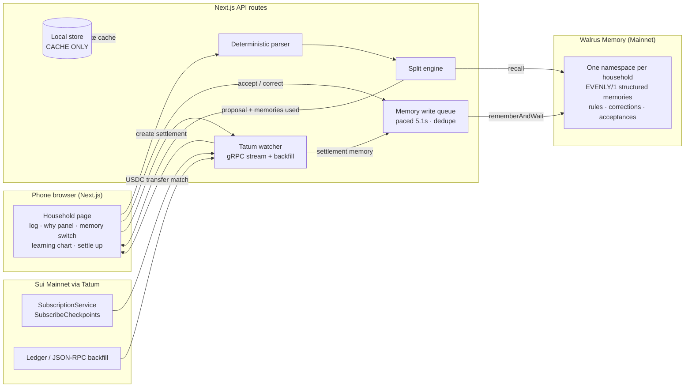

# Evenly

**Shared money that remembers.** For couples and roommates: log a purchase in **one line**,
Evenly proposes the split from what your household has taught it — stored in **Walrus Memory** —
and settling up is a **USDC transfer on Sui** that the app detects live through **Tatum** and
flips to *Settled* in front of you.

Built for the **Total Recall** hackathon (Tatum × Walrus Memory).

## The learning loop (the point of Evenly)

1. **Log** — `groceries 12000 paid by Ada`. A deterministic parser (no LLM) reads the amount,
   the payer, the description and the category.
2. **Recall** — Evenly recalls the household's Walrus memories (one namespace per household)
   and the split engine proposes: *corrections* outrank *rules*, rules outrank *general habits*,
   anything beats a blind equal split.
3. **Why panel** — every proposal shows the exact memories behind it, blob ids included.
4. **Accept or correct** — both become new memories (plus a derived rule). Correct groceries
   to 70/30 once and the next groceries proposal *is* 70/30, citing your correction.
5. **Memory switch** — turn memory off and proposals drop back to plain equal splits; the
   difference is visible on the same screen.
6. **Learning chart** — the share of proposals accepted *without an edit*, per week, computed
   only from real decision events. If Evenly is learning, the line goes up.

## Live settlement

- Create settlements from balances (greedy debtor→creditor pairing) at an exchange rate the
  household sets itself — Evenly never invents FX.
- A server-side **Tatum Sui gRPC `SubscribeCheckpoints` stream** (TLS, `x-api-key` metadata,
  field mask) watches the chain. Streams start at the tip and cannot resume, so every
  connect/reconnect first runs a **polling backfill** (`sui_queryTransactionBlocks`, cached,
  rate-limit aware) — the stream gives speed, the backfill gives reliability.
- A transfer settles a settlement when it is **Circle USDC**, debtor → creditor, and ≥ 99% of
  the expected amount. The page flips to ✅ Settled via SSE, with the transaction digest and a
  Sui explorer link, and the settlement itself is written back as a memory.

## Ownership & proof

- Each member can hold a **delegate key** on the household's memory account (SDK-generated;
  private key shown once to the member, never stored; owner adds public keys on-chain, max 20).
- **Revoke** stops a member's access — the UI honestly shows *"revoking…"* for the ~30 seconds
  that verification caching can lag, instead of pretending removal is instant.
- **Restart proof** (`/proof/<householdId>`): drains the memory write queue, wipes *all* local
  state, and rebuilds every household from its Walrus namespace alone — members, expenses with
  their remembered split weights, settlements, and balances that match to the minor unit.

## Architecture



## Memory format

Every memory is one human-readable line — open any blob and you can read what Evenly learned:

```
EVENLY/1 kind=correction household=<id> category=groceries weights=Ada:70,Ben:30 note=Ada buys most of the food
```

Kinds: `household`, `member`, `expense`, `rule`, `correction`, `acceptance`,
`settlement_habit`, `settlement`.

## Run it

```bash
npm install
npm run dev        # http://localhost:3000
npm test           # 37 unit tests: parser, money, serialisation, split engine, settlement matching, learning chart
npm run build
npx tsx scripts/seed-memories.ts <householdId>   # seed a demo household with 12 memories
```

## Environment variables

Set in **Vercel → Project → Settings → Environment Variables** (see `.env.example`).
Secrets are never committed, and Evenly never asks for a private key in chat.

| Variable | What |
|---|---|
| `MEMWAL_ACCOUNT_ID` | Walrus Memory account id |
| `MEMWAL_DELEGATE_KEY` | Delegate private key for the account |
| `MEMWAL_SERVER_URL` | Relayer URL (default `https://relayer.memory.walrus.xyz`) |
| `TATUM_API_KEY` | Tatum API key (Sui mainnet) |
| `TATUM_SUI_GRPC_URL` | Default `https://sui-mainnet-grpc.gateway.tatum.io` |
| `TATUM_SUI_RPC_URL` | Default `https://sui-mainnet.gateway.tatum.io` |

Without keys the app still runs end-to-end on a **clearly labelled simulated** local memory
with settlement detection inactive — nothing fake is ever presented as real.
See the in-app `/limits` page.

## More in `docs/`

- `docs/blog-post.md` — announcement post draft
- `docs/demo-script.md` — the 90-second demo, timed
- `docs/x-post.md` — launch post draft
- `docs/submission-checklist.md` — final submission checklist with evidence links
